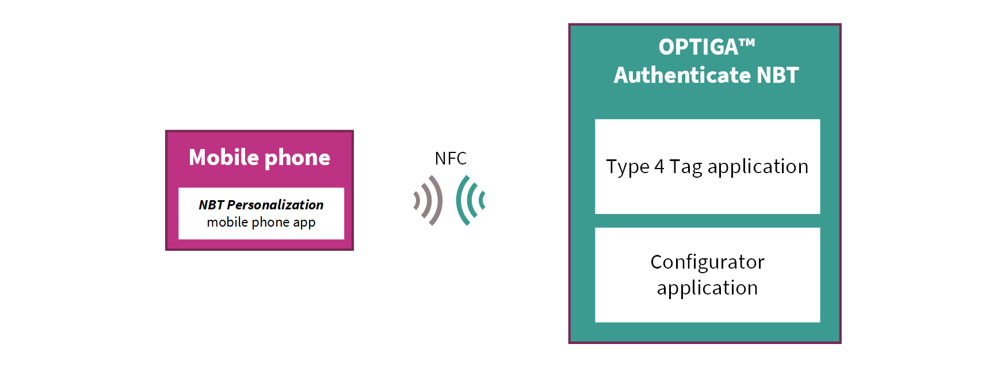

<!--
SPDX-FileCopyrightText: Copyright (c) 2024-2026 Infineon Technologies AG
SPDX-License-Identifier: CC-BY-4.0
-->

# OPTIGA™ Authenticate NBT PERSO Application for iOS

This is the *NBT Personalization* mobile phone app, a Swift-based *Xcode* project which demonstrates the *personalization of the [OPTIGA™ Authenticate NBT](https://www.infineon.com/part/optiga-authenticate-nbt) via NFC (PERSO)*.

## Overview

The example application enables an iPhone to perform the personalization of the OPTIGA™ Authenticate NBT for the reference use cases provided by Infineon Technologies with pre-defined configurations.
This implementation is not intended to perform any specific use case on its own, however, it allows the user to prepare a sample for a specific usage. Simultaneously, it provides an example on how to use the [OPTIGA™ Authenticate NBT Host Library for Swift](https://github.com/Infineon/optiga-nbt-lib-swift) in iOS applications for personalization purposes.

The application is intended to personalize the OPTIGA™ Authenticate NBT samples for four different use cases:

- *Host parameterization via asynchronous data transfer*
- *Host parameterization via pass-through*
- *Brand protection*
- *Static connection handover*

Refer to the [OPTIGA™ Authenticate NBT: Host software overview](https://github.com/Infineon/optiga-nbt) repository for an overview of the available host software for the OPTIGA™ Authenticate NBT.

### Features

- iOS application with user interface and NFC communication capability
- Example implementation to personalize the OPTIGA™ Authenticate NBT
- Sample usage of the [OPTIGA™ Authenticate NBT Host Library for Swift](https://github.com/Infineon/optiga-nbt-lib-swift) (ref v1.1.3)

### Documentation

Dedicated documentation for the whole host software offering of the OPTIGA™ Authenticate NBT is available on [GitHub.io](https://infineon.github.io/optiga-nbt).
The online documentation includes an own section to the [Personalization examples](https://infineon.github.io/optiga-nbt/3600_uc-perso.html) which contains a subpage for this [iOS app](https://infineon.github.io/optiga-nbt/projects/optiga-nbt-example-perso-ios/index.html).

## Getting started

For information on how to setup and use this example, refer to the [host software documentation](https://infineon.github.io/optiga-nbt/projects/optiga-nbt-example-perso-ios/index.html).

### Requirements

- NFC-enabled iOS device running iOS 15 or higher
- macOS computer running Xcode (Apple's IDE for Mac and iOS apps)
- Apple Developer account

### Setup

This project is intended to be used with *Xcode*.
To open the project, import it into *Xcode* via *Clone Git Repository...* option in the startup screen and enter the *path to this repository*.

Alternatively, clone the repo to a local folder and import the folder into *Xcode* (via selecting *File->Open*).

### Usage

After installation, the iOS app can be started and used to evaluate the OPTIGA™ Authenticate NBT's personalization functionality. See [host software documentation](https://infineon.github.io/optiga-nbt/projects/optiga-nbt-example-perso-ios/index.html) for more information.

To make sure the mobile phone app works as intended, NFC needs to be enabled on the iOS device. Additionally, the app's permissions must be set correctly.

## Additional information

This section lists additional resources and information related to this repository.

### Contact

In case of questions regarding this repository and its contents, refer to [MAINTAINERS.md](MAINTAINERS.md) for the contact details of this project's maintainers.

### Contributing

Please read [CONTRIBUTING.md](CONTRIBUTING.md) for detailed contribution instructions and refer to our [CODE_OF_CONDUCT.md](CODE_OF_CONDUCT.md).

### Licensing

Please see our [LICENSE](LICENSE) for copyright and license information.

This project follows the [REUSE](https://reuse.software/) approach, so copyright and licensing
information is available for every file (including third party components) either in the file
header, an individual *.license file or a REUSE.toml file. All licenses can be found in the
[LICENSES](LICENSES) folder.

### Related resources

- [OPTIGA™ Authenticate NBT: Host software overview](https://github.com/Infineon/optiga-nbt)
- [OPTIGA™ Authenticate NBT: Host software documentation](https://infineon.github.io/optiga-nbt)
  - [*NBT Personalization* app](https://infineon.github.io/optiga-nbt/projects/optiga-nbt-example-perso-ios/index.html)
- [OPTIGA™ Authenticate NBT: Product page](https://www.infineon.com/part/optiga-authenticate-nbt)
